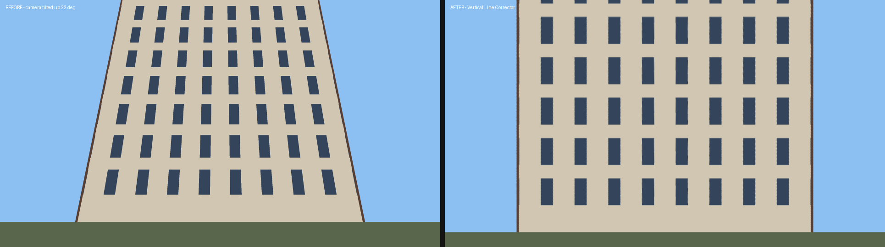

# Vertical Line Corrector for DaVinci Resolve

Fixes **keystoning** (converging verticals) so walls, poles and building edges stay straight and parallel on tilted gimbal or drone shots.



*A synthetic test shot with the camera tilted up 22°. Before the fix, the left wall leans 67 px over 324 rows. After the fix it leans 0 px.*

## How it works

Leaning walls aren't lens distortion. They happen because the camera was pitched up or down. The plugin re-renders the frame from a virtual **level** camera with a **shift lens**, the way an architectural tilt-shift lens or Lightroom's *Upright* does. Only the camera rotation changes, so the correction is an exact perspective transform (a homography). Every vertical line in the real world comes out vertical, and the middle of your shot stays in the middle of the frame.

## Two versions

| | `VerticalLineCorrector.dctl` | `VerticalLineCorrector.setting` |
|---|---|---|
| Where | Color page (OpenFX → DCTL) | Edit page Effects, Fusion page |
| Resolve | **Studio** (DCTL effect) | **Free** and Studio |
| Runs on | GPU (CUDA / Metal / OpenCL) | Fusion's built-in Corner Positioner |
| Extras | Edge mode (black / extend / mirror), guide grid | – |

Both versions use the same geometry and the same controls.

## Install

**DCTL (Color page)**
1. Copy `VerticalLineCorrector.dctl` into Resolve's LUT folder:
   - macOS: `/Library/Application Support/Blackmagic Design/DaVinci Resolve/LUT/`
   - Windows: `C:\ProgramData\Blackmagic Design\DaVinci Resolve\Support\LUT\`
   - Linux: `/opt/resolve/LUT/` (or `~/.local/share/DaVinciResolve/LUT/`)
2. Restart Resolve, or click **Update Lists** in Project Settings → Color Management → Lookup Tables.
3. On the Color page, drag **OpenFX → DCTL** onto a node and pick `VerticalLineCorrector` from the *DCTL List*.

**Fusion macro (Edit page effect, works in free Resolve)**
1. Copy `VerticalLineCorrector.setting` into:
   - macOS: `~/Library/Application Support/Blackmagic Design/DaVinci Resolve/Fusion/Templates/Edit/Effects/`
   - Windows: `%APPDATA%\Blackmagic Design\DaVinci Resolve\Support\Fusion\Templates\Edit\Effects\`
   - Linux: `~/.local/share/DaVinciResolve/Fusion/Templates/Edit/Effects/`
2. Restart Resolve. **Vertical Line Corrector** then shows up in Effects → Toolbox → Effects on the Edit page. Drop it on a clip.

## Controls

| Control | What it does |
|---|---|
| **Vertical Tilt** | Main control. Set it to how far the camera was pitched (degrees). Positive means the camera looked up and walls lean in at the top. If the walls lean more, flip the sign. |
| **Horizontal Tilt** | Fixes a facade shot off-axis, where horizontal lines converge sideways. |
| **Level Horizon** | Removes roll and levels the horizon. |
| **Correction Amount** | 100% makes lines perfectly vertical. 70–85% often looks more natural on tall buildings because it keeps a little of the upward feel. |
| **Lens Horizontal FOV** | The lens's horizontal field of view. Getting this right makes the correction exact. See the table below. |
| **Zoom** | Extra zoom on top of auto fill. |
| **Shift X / Y** | Recomposes the frame after correction, for example to keep a rooftop in shot. |
| **Auto Fill Frame** | Zooms just enough to hide the empty corners the warp creates. It takes Shift into account. |
| **Edges** *(DCTL)* | What shows outside the footage if auto fill is off: black, extended edge pixels, or a mirror image. |
| **Show Guide Grid** *(DCTL)* | Turns on an overlay grid to line walls up against while you dial in the tilt. Switch it off before rendering. |

### Typical horizontal FOV values

| Camera | 16:9 horizontal FOV |
|---|---|
| DJI Mini 3/4 Pro, Air 2S, Air 3 (wide) | ~75–80° |
| DJI Mavic 3 (Hasselblad) | ~72° |
| GoPro (Linear mode) | ~85–90° |
| iPhone main camera (1×) | ~65–70° |
| Gimbal with 24 mm full-frame lens | ~74° |

**Quick workflow:** turn on the guide grid, raise **Vertical Tilt** until the building edges are parallel to the grid lines, then fine-tune **Lens FOV** if the lean is gone at the frame edges but not in the middle, or the other way around. On a moving drone shot, keyframe **Vertical Tilt** if the gimbal pitch changes during the shot.

> Fisheye footage or footage with strong barrel distortion needs lens correction first (for example Resolve's *Lens Distortion* in the Fusion page). This plugin assumes a rectilinear lens.

## Development

All geometry lives in `tools/reference.py`. The other files are ports of it, and each is checked against it:

```sh
cd tools
python3 test_reference.py                       # geometry unit tests
python3 build_macro.py                          # checks macro expressions vs reference, writes .setting
cc -O2 -Wall -o /tmp/harness dctl_harness.c -lm # compiles the real DCTL as C on the CPU
python3 render_demo.py /tmp/harness             # renders the demo and checks walls end up vertical
```

`VerticalLineCorrector.setting` is generated. Edit `tools/build_macro.py` instead.
